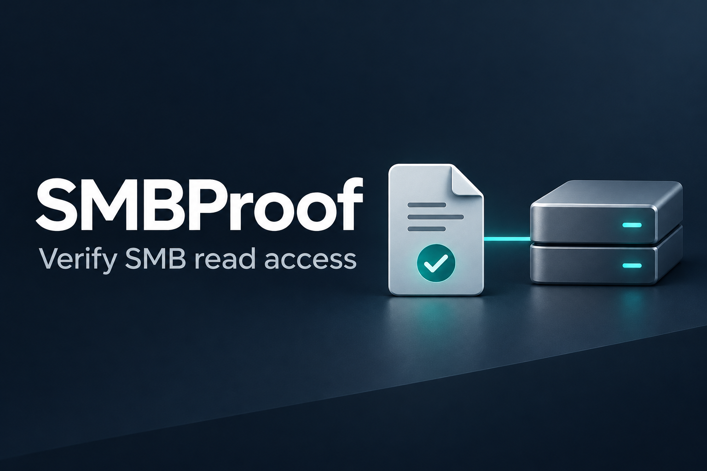
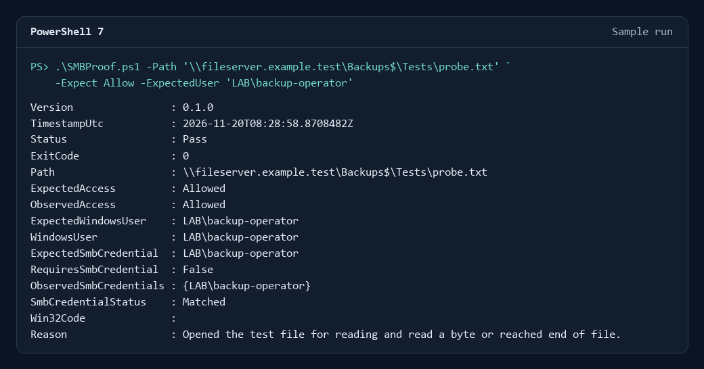
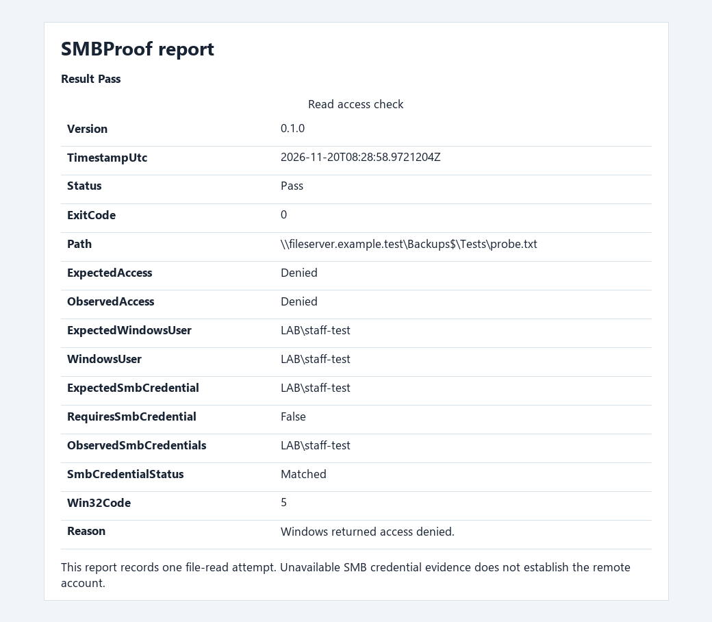

# SMBProof



Verify expected SMB read access from a specific Windows logon.

After an access change, use SMBProof to verify that an authorized account
can read a known test file on a share and that a restricted account receives
access denied on the same file. SMBProof opens only the supplied UNC file
for reading, reads one byte or reaches end of file, and discards the data.
It can produce a terminal result, JSON, or a standalone HTML report.

## Requirements

- Windows PowerShell 5.1 or PowerShell 7 on Windows.
- Access to the Windows logons you want to verify.
- A regular synthetic test file in a folder with the permissions you want to
  verify. Use [the sample probe](examples/probe.txt) or create your own.

SMBProof uses built-in Windows and PowerShell APIs. The CLI and its module
must be in the same folder.

## Quick start

Clone the repository or extract the source archive, then open PowerShell in
the source folder.

```powershell
git clone https://github.com/afrfuniverse/smbproof.git
Set-Location smbproof
```

1. From the Windows logon that should have access, run `whoami` and pass its
   output as `-ExpectedUser`. Use `-Expect Allow` to verify the file is readable.

   ```powershell
   .\SMBProof.ps1 -Path '\\fileserver.example.test\Backups$\Tests\probe.txt' `
     -Expect Allow -ExpectedUser 'LAB\backup-operator' -HtmlReport .\operator.html
   ```

2. From the logon that should be restricted, run the check against the same
   file. Use its own `whoami` value and set `-Expect Deny`.

   ```powershell
   .\SMBProof.ps1 -Path '\\fileserver.example.test\Backups$\Tests\probe.txt' `
     -Expect Deny -ExpectedUser 'LAB\staff-test' -Format Json -HtmlReport .\staff.html
   ```

Replace the example path and accounts with your own values. Use a UNC path
with a server, share, and file name. Single quotes preserve the `$` in a
hidden share name. Run the allow check first so you have a baseline for the
same file before interpreting the deny check.

## Command options

| Parameter | Description |
| --- | --- |
| `-Path` | Required. UNC path to the exact test file. |
| `-Expect` | Required. `Allow` or `Deny`. |
| `-ExpectedUser` | Required. Windows identity as shown by `whoami`. A mismatch skips the file probe. |
| `-ExpectedSmbCredential` | Optional. Require a single matching credential from the SMB client's connection metadata. |
| `-Format` | Optional. `Text` by default or `Json` for machine-readable results. |
| `-HtmlReport` | Optional. Write a standalone report to a new file in an existing directory. |

## Results and reports

| Exit code | Status | Meaning |
| --- | --- | --- |
| `0` | `Pass` | The observed read access matched the expectation. |
| `1` | `Fail` | The observed read access differed from the expectation. |
| `2` | `Inconclusive` | Identity or file access evidence was insufficient. Runtime and report errors also return `2` and write to stderr. |

For example, `Pass` with `ExpectedAccess = Denied` and
`ObservedAccess = Denied` means Windows returned access denied as expected.
A missing file, a network failure, a sign-in failure, or a file locking
conflict returns `Inconclusive`. Use `Reason` and `Win32Code` when available
to investigate the result.

JSON contains the UTC timestamp, access result, Windows identity, and SMB
credential evidence. In PowerShell, read `$LASTEXITCODE` immediately after
the command to use the result in automation. HTML is self-contained. Choose
a new output filename for each run, since report creation preserves existing
files. Both formats contain the UNC path and account names.

## Screenshots

These images show SMBProof output rendered from simulated SMB responses and
example accounts.

### PowerShell output

The backup operator can read the test file as expected.



### HTML report

The restricted account receives the expected access denial, so the report
shows the check passed.



## SMB credential evidence

Windows can reconnect to a share using a saved or explicitly supplied SMB
credential. SMBProof checks the Windows logon before reading and queries
`Get-SmbConnection` for observable client credential evidence. The expected
SMB credential defaults to `-ExpectedUser`.

| `SmbCredentialStatus` | Interpretation |
| --- | --- |
| `Matched` | One observed credential matched the expected value. |
| `Different` | One observed credential differed from the expected value. Result is `Inconclusive`. |
| `Ambiguous` | Multiple credentials were observed for the target. Result is `Inconclusive`. |
| `Unavailable` | No matching client metadata was readable. An explicit credential requirement makes the result `Inconclusive`. Otherwise the access result describes the local Windows logon and file operation. |
| `NotChecked` | The Windows identity check prevented a file probe. |

Set `-ExpectedSmbCredential` explicitly when the check depends on observed
SMB credentials.

```powershell
.\SMBProof.ps1 -Path '\\fileserver.example.test\Backups$\Tests\probe.txt' `
  -Expect Allow -ExpectedUser 'LAB\backup-operator' `
  -ExpectedSmbCredential 'LAB\backup-operator' -Format Json
```

The report describes one read attempt for one file. Diagnosing the policy
behind an access denial requires inspecting the relevant SMB, NTFS, and
client settings.

## Local tests

```powershell
powershell.exe -NoProfile -File .\tests\SMBProof.Tests.ps1
pwsh.exe -NoProfile -File .\tests\SMBProof.Tests.ps1
```

The suite covers Windows file I/O, simulated SMB outcomes, the command-line
interface, and report generation. For an end-to-end check, use an isolated
SMB share with one known allowed account and one known denied account and
repeat the quick-start checks.

## Windows references

- [SMB client connection metadata](https://learn.microsoft.com/en-us/powershell/module/smbshare/get-smbconnection)
- [Win32 system error codes](https://learn.microsoft.com/en-us/windows/win32/debug/system-error-codes--0-499-)

## Author and license

Created by [Alireza Foroughifar (@afrfuniverse)](https://github.com/afrfuniverse).

SMBProof is available under the [MIT License](LICENSE). When redistributing
copies or substantial portions, keep the copyright and permission notices
from `LICENSE`, including the author's GitHub handle and profile link.
